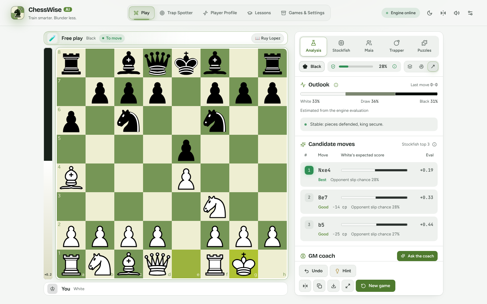
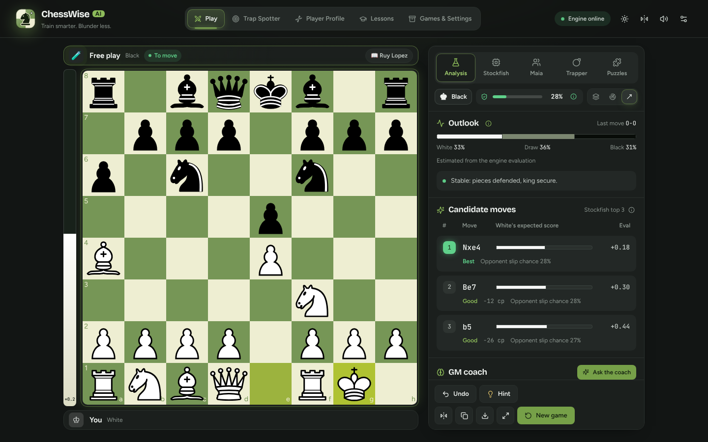
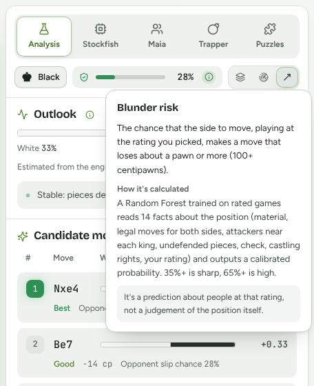
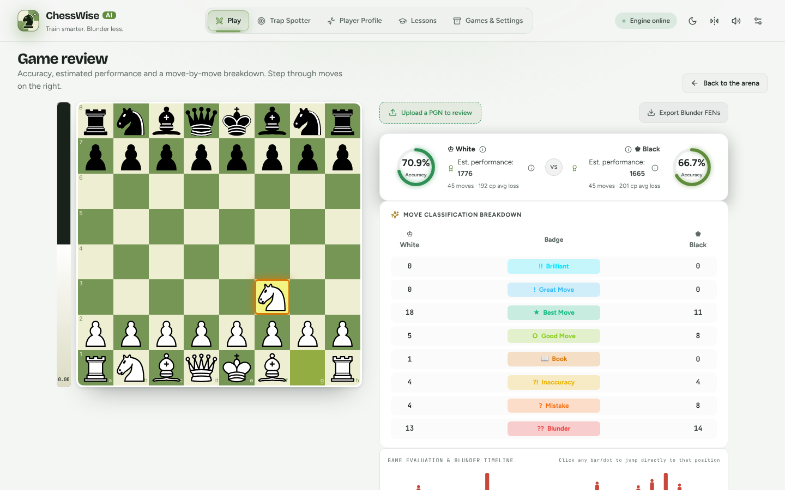
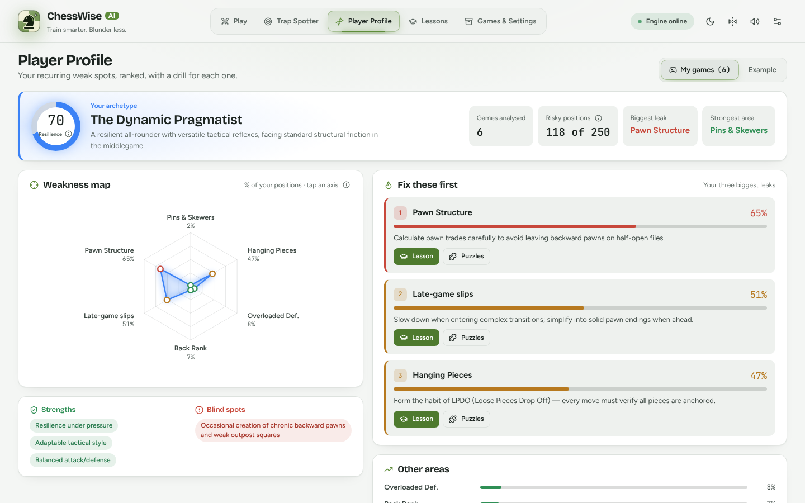
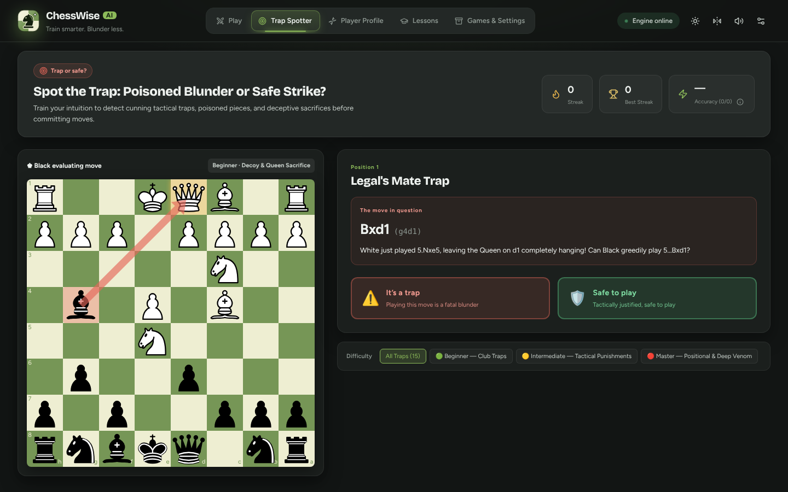
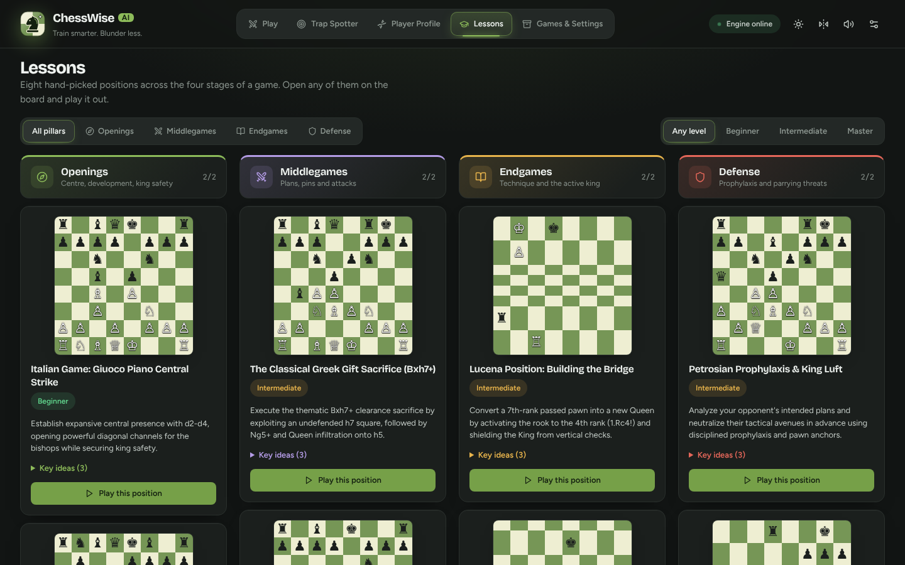
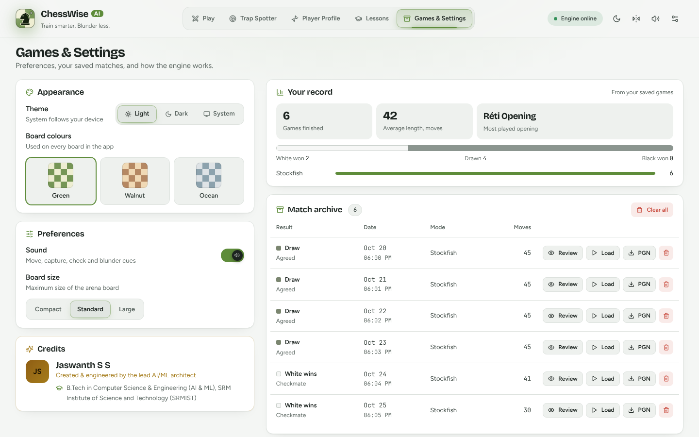
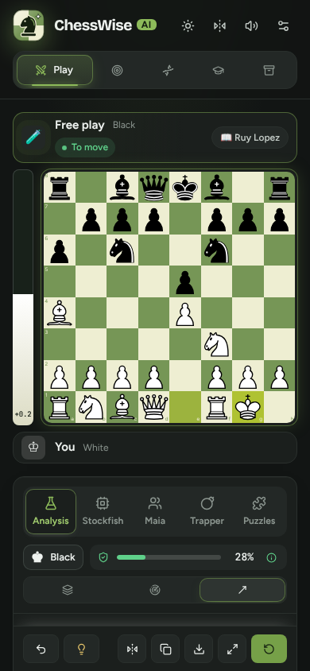

<div align="center">

# ♟️ ChessWise AI

### Train smarter. Blunder less.

[](https://www.python.org/)
[](https://fastapi.tiangolo.com/)
[](https://react.dev/)
[](https://www.typescriptlang.org/)
[](https://vitejs.dev/)
[](https://scikit-learn.org/)
[](https://stockfishchess.org/)
[](./LICENSE)

ChessWise is a chess trainer that predicts **when you're likely to blunder**, explains why, and drills you on the patterns that cost you games. It combines a calibrated machine-learning model, Stockfish, and a coach, and every number it shows comes with an explanation.



📑 Project report: [`docs/CHESSWISE_PROJECT_REPORT.docx`](./docs/CHESSWISE_PROJECT_REPORT.docx)

</div>

---

## Contents

- [Screenshots](#-screenshots)
- [Features](#-features)
- [What the numbers mean](#-what-the-numbers-mean)
- [Getting started](#-getting-started)
- [Training the blunder model](#-training-the-blunder-model)
- [Testing](#-testing)
- [API reference](#-api-reference)
- [Project structure](#-project-structure)

---

## 📸 Screenshots

| Play, dark mode | Every number explains itself |
| :---: | :---: |
|  |  |
| **Game review** | **Player profile** |
|  |  |
| **Trap Spotter** | **Lessons** |
|  |  |
| **Games & Settings** | **Phone** |
|  |  |

<sub>The screenshots were taken with Stockfish connected and a small demo model trained on engine self-play, so the exact percentages are illustrative.</sub>

---

## 🌟 Features

### Play
- **Five modes, each keeping its own game.** Switching modes parks the current game and brings back the other one.
  - **Analysis:** free play with live feedback.
  - **Stockfish:** play the engine, with strength mapped to search depth.
  - **Maia:** a human-like opponent at a chosen rating (optional Maia-2).
  - **Trapper:** a bot that picks sound moves which maximise *your* predicted blunder chance.
  - **Puzzles:** classic opening traps played as puzzles.
- **Rated games lock your rating** until the game ends or you start a new one.
- **The game panel** holds blunder risk, the Outlook (win/draw/loss), Stockfish's top 3 moves, a threat radar, the coach and the move list.
- **Board overlays:** square influence, threat highlights and candidate arrows.

### Review
- **Upload a PGN or review any saved game.**
- **Scores for each side:** accuracy and estimated performance.
- **Move badges:** best, good, inaccuracy, mistake and blunder.
- **An evaluation and blunder timeline** you can click to jump through the game.
- **Export** the critical positions as FENs for practice.

### Improve
- **Player Profile:**
  - **Weakness map:** six weakness rates measured from *your* side of your saved games (hanging pieces, pins, overloaded defenders, back rank, pawn structure, late-game slips).
  - **Your top three leaks,** each with a lesson and puzzles.
- **Trap Spotter:** decide whether a tempting move is a trap or safe to play, with streaks and accuracy.
- **Lessons:** hand-picked positions across openings, middlegames, endgames and defense, each one playable on the board.
- **GM coach:**
  - It uses Gemini when `GEMINI_API_KEY` is set, and a deterministic coach otherwise.
  - Advice is built from the engine's candidate moves, the blunder risk, the detected motifs and your profile archetype.

### Look and feel
- **"Modern slate" theme** in light and dark. It follows your device, or you can pick one in Settings.
- **Three board colour sets:** green, walnut and ocean.
- **Board sizes:** Standard fits the window height; Large fills the width.
- **Fonts:** Bricolage Grotesque for headings, Figtree for text and JetBrains Mono for notation.
- **Responsive** from phones to wide screens, with reduced-motion support.

---

## 🔢 What the numbers mean

Every metric in the app has an ⓘ button with this explanation. When a backend piece is missing, the app shows **"—" with the reason** (for example "Needs Stockfish") instead of a made-up number.

| Number | What it is | How it's calculated |
| :--- | :--- | :--- |
| **Blunder risk** | Chance that the side to move, at your chosen rating, plays a move that loses about a pawn or more (≥100 centipawns). | A calibrated Random Forest over 14 position facts: material, mobility, king attackers, undefended pieces, check, castling rights and rating. 35%+ is sharp; 65%+ is high. |
| **Opponent slip chance** | If you play this candidate, the chance your opponent blunders in reply. | The same model, run on the position after the move. |
| **White / Draw / Black** | A rough outcome estimate. | A formula on Stockfish's eval: a logistic curve (about 10% per pawn), with up to 36% draw when level. It is not game statistics. |
| **Eval bar** | Stockfish's score from White's side. | Filled using the same curve as the Outlook. |
| **Centre control** | Each side's share of influence on d4, e4, d5 and e5. | Attackers plus the occupying piece, per side. |
| **Accuracy** | How close moves were to Stockfish's best (0–100). | Each move scores `100 × e^(−0.0035 × cp lost)`, averaged over the game. This is our own formula, so it won't match chess.com or Lichess exactly. |
| **Est. performance** | A ballpark rating for one game. | `600 + 22 × accuracy − 2 × avg cp lost`, clamped to 400–3100. |
| **Profile weakness rates** | The % of your positions (just before you moved) where that weakness was on your side. | Counted by replaying your saved games. Late-game slips use positions after move 25, since there's no clock data. |
| **Resilience** | How rarely those weaknesses appear. | 100 minus the average of the six rates. |

---

## 🚀 Getting started

### Prerequisites
- Python 3.11+
- Node.js 18+ and npm
- [Stockfish](https://stockfishchess.org/download/) for your OS

### 1. Clone and configure

```bash
git clone https://github.com/mailtojaswanthss-svg/chess-project.git
cd chess-project
cp .env.example .env
```

Edit `.env`:

```env
STOCKFISH_PATH=C:/path/to/stockfish.exe
MODEL_PATH=ml/models/blunder_model.joblib
BLUNDER_LOSS_CENTIPAWNS=100
FRONTEND_ORIGINS=http://localhost:5173,http://127.0.0.1:5173
```

To use the Gemini coach, set `GEMINI_API_KEY` in the environment that starts the backend (optionally also `GEMINI_MODEL_ID`). Without it, the deterministic coach is used.

### 2. Install

```bash
python -m venv .venv
# Windows: .\.venv\Scripts\Activate.ps1    macOS/Linux: source .venv/bin/activate
pip install -e ".[dev]"

cd frontend && npm ci && cd ..
```

### 3. Run

- **Windows, one click:** run `start-chesswise.bat`, or `.\start-chesswise.ps1`. This starts the API on port 8000 and the app on port 5173. To shut both down, run `stop-chesswise.bat`.
- **Manually:**

  ```bash
  uvicorn chess_trainer.api:app --reload --app-dir backend --port 8000   # terminal 1
  cd frontend && npm run dev                                              # terminal 2
  ```

- **Docker:** `docker compose up --build`

Open **http://localhost:5173**. API docs are at http://localhost:8000/docs.

**What works without extras.** A fresh clone has no trained model, because `ml/models/*.joblib` is gitignored.
- The header shows **"Limited"** and blunder risk shows "— Needs the blunder model".
- Everything else works once Stockfish is set.
- Without Stockfish, the eval, the Outlook and the candidate moves show "Needs Stockfish".

---

## 🧠 Training the blunder model

```bash
# 1. Download games from public Lichess players
chess-download "username1 username2" --output data/raw/training_games.pgn --max-games 200

# 2. Label every move with Stockfish and train
chess-train data/raw/training_games.pgn --output ml/models/blunder_model.joblib --stockfish-path <path-to-stockfish> --depth 8
```

- **Labels:** a move counts as a blunder when it loses at least `BLUNDER_LOSS_CENTIPAWNS` against Stockfish.
- **Evaluation:** whole players are held out, so the model is tested on people it hasn't seen.
- **Report:**
  - majority-class and logistic-regression baselines
  - precision, recall and F1
  - ROC-AUC with a game-bootstrap 95% CI
  - PR-AUC and top-decile lift
  - calibration (ECE and Brier score)

  It's saved next to the model as `*.metrics.json`.

---

## 🧪 Testing

```bash
python -m pytest -q                       # backend tests
cd backend && python -m evals.run_evals   # coach evals, writes eval_report.json
cd frontend && npm run build              # frontend typecheck + build
```

---

## 📡 API reference

Interactive docs: `http://127.0.0.1:8000/docs`

| Method | Endpoint | Description |
| :--- | :--- | :--- |
| `GET` | `/health` | Status, model metrics, `engine_ready`, `maia_available` |
| `POST` | `/predict` | Blunder probability for a FEN and rating |
| `POST` | `/tactical-analysis` | Threats, top-3 engine moves, blunder risk and win chances. Missing pieces come back as `null` with `risk_source` / `eval_source: "unavailable"`. |
| `POST` | `/coach-advice` | Structured coaching advice (Gemini or deterministic) |
| `POST` | `/move` | Stockfish move at a given strength |
| `POST` | `/trap-move` | Sound move that maximises the opponent's blunder risk |
| `POST` | `/maia-move` | Human-like move from Maia-2 (optional install) |
| `POST` | `/analyze-game` | Full PGN review: per-move risk, loss, badges, accuracy and performance |
| `POST` | `/territory-control` | Per-square influence and centre control |
| `POST` | `/blunder-dna` | Weakness profile from `games: [{pgn, player_color}]` |
| `GET` | `/trap-puzzles`, `/trap-puzzles/{id}` | Trap Spotter positions |

---

## 📂 Project structure

```text
backend/chess_trainer/
  api.py          FastAPI app; shared position analysis for /tactical-analysis and /coach-advice
  engine.py       Stockfish wrapper (one shared process for the API, private engines for scripts)
  model.py        BlunderModel training, calibration and metrics
  features.py     The 14 position features the model reads
  analysis.py     PGN review: per-move loss, badges, accuracy, performance
  coach.py        Gemini / deterministic coach
  profiler.py     Player Profile weakness rates
  territory.py    Square influence and centre control
  traps.py        Trap Spotter positions
  maia.py         Optional Maia-2 adapter (model cached once per process)
  cli.py, dataset.py, ingest.py, config.py
backend/evals/    Coach evaluation suite
frontend/src/
  App.tsx         App shell, per-mode game sessions
  components/     arena/ (play screen), review/, MetricInfo (ⓘ popovers), page views
  styles/         tokens.css (light/dark themes), base, layout, motion
  utils/          metricCopy.ts (metric explanations), chess helpers, appearance, puzzles
tests/            Pytest suite
docs/             Report, deployment guide, screenshots
ml/               Model metrics and report scripts
```

---

## 📄 License

[MIT](./LICENSE)

## 🤝 Acknowledgments

[Stockfish](https://stockfishchess.org/) · [python-chess](https://python-chess.readthedocs.io/) · [Lichess](https://lichess.org/) · [Maia Chess](https://maiachess.com/) · [react-chessboard](https://github.com/Clariity/react-chessboard) · [chess.js](https://github.com/jhlywa/chess.js)
